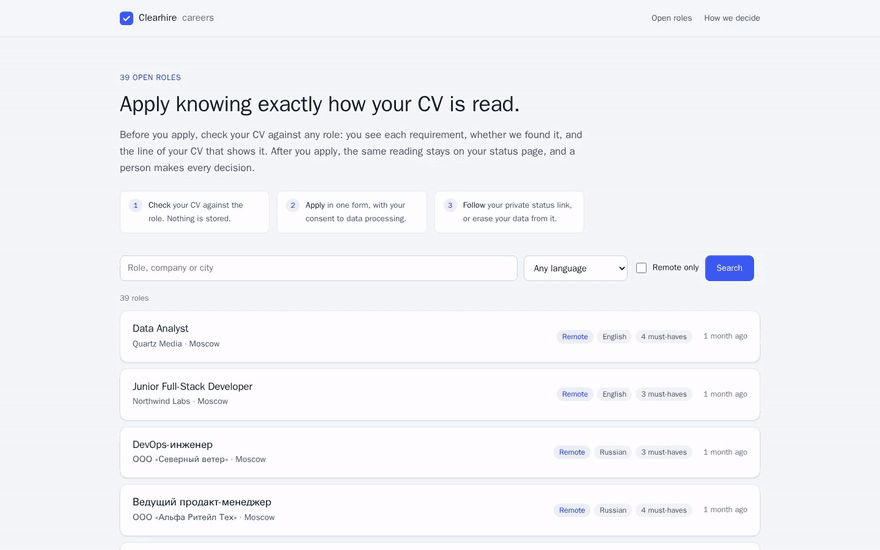
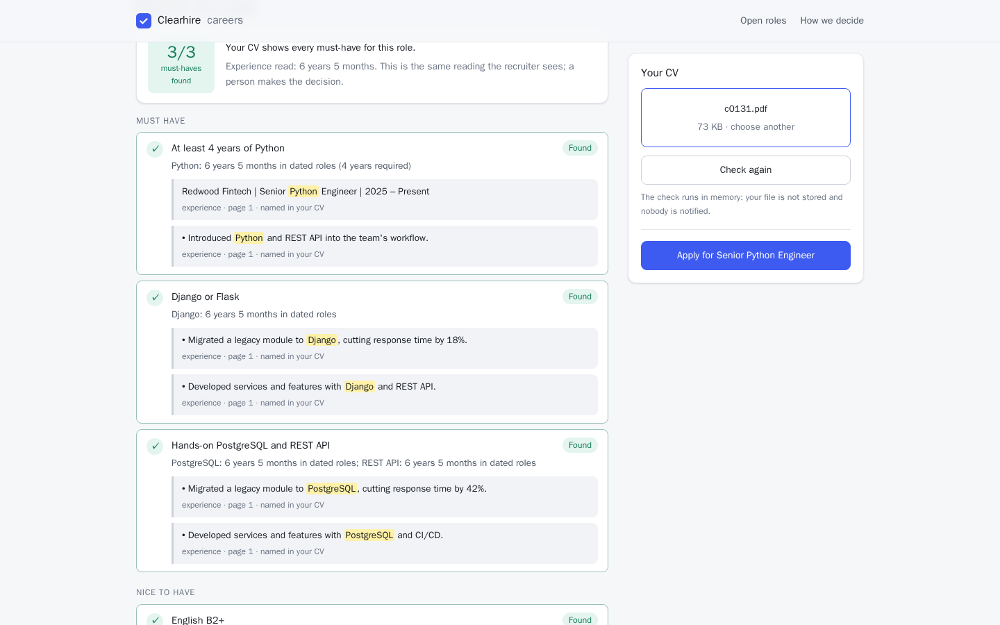
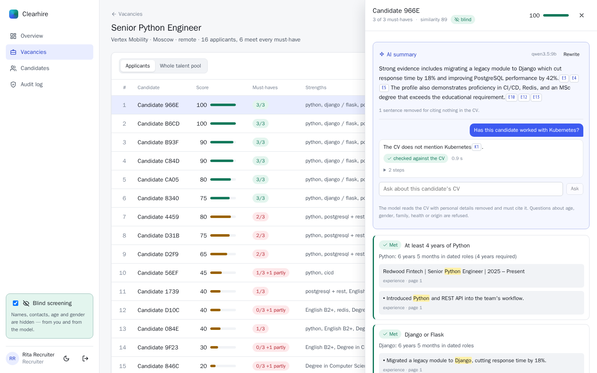
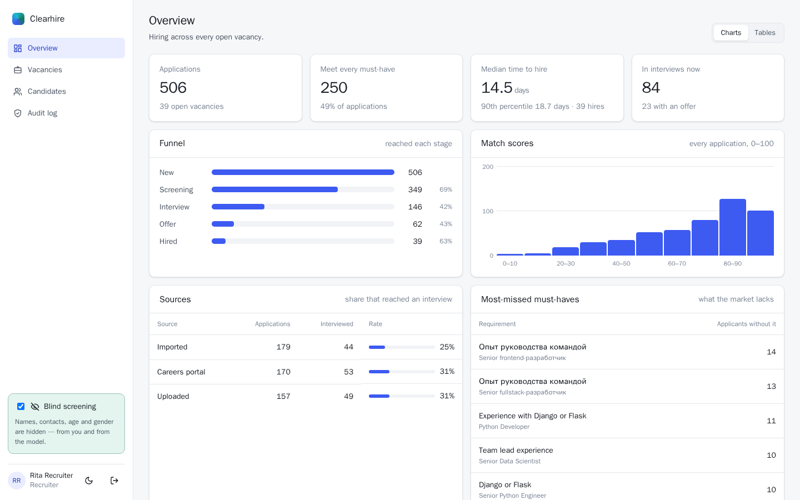
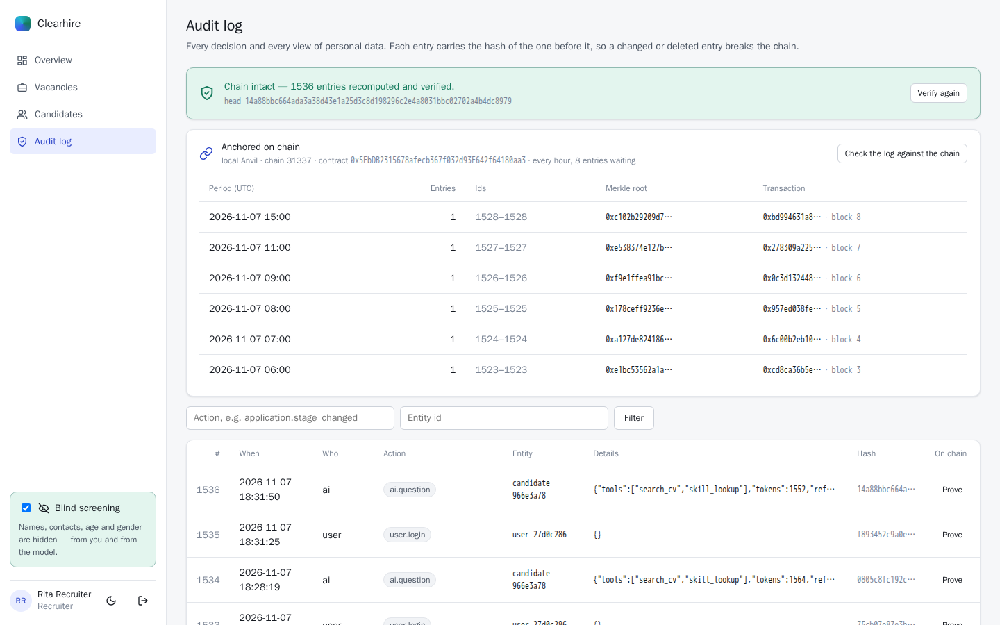

# Clearhire

**Recruiting that shows its work.** Clearhire reads CVs (PDF, Word, scans and photos, in Russian and
English), checks them against each requirement of a vacancy, and shows the line of the CV behind every
verdict. Screening is blind, a local LLM writes summaries that must cite their evidence, and every decision
goes into an audit log whose hashes are anchored in a smart contract.

**Live demo:** [careers site](https://149-36-1-90.sslip.io) · [recruiter console](https://console.149-36-1-90.sslip.io)
(sign in with one of the demo-account buttons; staff accounts are read-only, candidates can still check a
CV, apply and erase their data). All people, companies and CVs in it are synthetic.

[](docs/demo/clearhire-demo.mp4)

<sub>One-minute walkthrough of the live demo ([MP4](docs/demo/clearhire-demo.mp4)), recorded by
[`docs/demo/record.mjs`](docs/demo/record.mjs) with Playwright.</sub>

## What it does

**For candidates** (Next.js careers site, Telegram bot)
- Check a CV against a role before applying: each requirement found or not, with the sentence that shows
  it. The check runs in memory; the file is not stored.
- Apply with explicit consent (152-FZ), follow the application by a private link or in Telegram, and erase
  it at any time.

**For recruiters and hiring managers** (Angular console)
- Requirements are read from the vacancy text into structured checks (skills, years, language level,
  degree) that the recruiter can edit.
- Candidates are ranked by unmet must-haves first, then by requirement score, then by similarity, so a
  CV that sounds right but lacks a must-have never outranks one that has it.
- Hybrid search over the whole pool (keywords, meaning and skills), a pipeline board and funnel analytics.
- An AI assistant on a local model: a match summary, and answers to questions about the CV. Both cite the
  passages they rest on, and sentences that cite nothing are dropped.
- Blind by default. Hiring managers can't turn it off, and questions about age, gender, health and other
  protected traits are refused before the model sees them.
- An audit log chained by SHA-256. Every hour its Merkle root is written to the `AuditAnchor` contract,
  and any entry can be proven against the chain.

| Candidate checks a CV before applying | Recruiter ranking, with the AI summary and a question |
| --- | --- |
|  |  |
| **Overview: funnel, scores, most-missed must-haves** | **Audit log: hash chain verified, roots anchored on chain** |
|  |  |

## Measured results

From `clearhire eval` on the synthetic dataset (312 CVs, 33 of them scans, and 39 vacancies;
[full results](eval/results.md)) and `clearhire eval-assistant` with Qwen 3.5 9B
([full results](eval/assistant.md)):

| | |
| --- | --- |
| Ranking quality, nDCG@10 | **0.972** (embeddings only 0.603, BM25 0.658; a perfect ranking scores 1.0) |
| Skills read from CVs, F1 | **0.997** overall, 0.985 on scans via OCR |
| Vacancy requirements parsed exactly | **100%** of 262 lines |
| "Meets every must-have" | precision 0.997, recall 0.985 |
| Blind mode: same CV, other gender, origin or age | **identical** score in 100% of 486 comparisons |
| Assistant answers to yes/no skill questions | 60/60 correct; 92% of summary sentences kept with a citation |
| Protected questions refused / fair ones wrongly refused | 16/16 / 0/16 |
| Ranking 312 CVs for a vacancy | 37 ms; reading a CV 262 ms (2 s for a scan) |

The dataset is generated (`clearhire synth`) with known truth for every CV, which is what makes these
numbers measurable. Real CVs are messier: treat them as a regression suite, not a claim about the world.

## Architecture

```
  candidates ─► careers (Next.js 16) ─┐                         ┌─► PostgreSQL 17 + pgvector
  Telegram   ─► bot (NestJS, grammY) ─┼─► API (FastAPI) ────────┼─► Redis: job queue, events
  recruiters ─► console (Angular 22) ─┘     │      ▲            └─► Ollama: Qwen 3.5 9B (GPU)
                                            ▼      │
                                worker (Taskiq): read CV, OCR, embed, match
                                anchor: Merkle roots ─► AuditAnchor.sol (EVM)
```

| Folder | What is in it |
| --- | --- |
| [`backend/`](backend) | Python 3.12: CV reading and OCR, requirement parsing, matching, search, the API, the worker, the assistant, anchoring |
| [`native/`](native) | C++ (pybind11) Aho-Corasick skill matcher; the Python fallback gives the same results (tested) |
| [`console/`](console) | Angular 22 recruiter console: signals, zoneless, strict CSP, no UI kit |
| [`portal/`](portal) | Next.js 16 careers site, server-rendered |
| [`bot/`](bot) | NestJS + grammY Telegram bot for candidates, and new-application alerts for recruiters |
| [`contracts/`](contracts) | `AuditAnchor.sol` with Foundry tests, which replay proofs written by the Python side |
| [`api/openapi.json`](api) | The API contract; the TypeScript clients are generated from it and CI checks they match |
| [`deploy/`](deploy) | Docker Compose for one host ([notes](deploy/README.md)) and a Helm chart for Kubernetes ([notes](deploy/helm/README.md)) |
| [`datasets/synthetic/`](datasets/synthetic) | 312 CVs, 39 vacancies and 216 fairness variants, all fictional, CC0 |
| [`eval/`](eval) | Evaluation results |

## Design decisions

- **Requirements, not one similarity score.** An embedding scores a CV on how it sounds. Clearhire checks
  each requirement separately and keeps the evidence, so a recruiter can see why, and a candidate can
  see what was read. Embeddings only break ties and power search.
- **Blind before the model, not after.** Names, contacts, age, gender and citizenship are replaced before
  the embedding model reads the text. Russian past-tense verbs carry gender ("разработал" /
  "разработала"), so the fairness test re-renders those too.
- **The LLM explains; it does not decide.** Ranking uses no LLM. The assistant gets the verdicts and
  numbered quotes, retrieval happens before the model is called, and a sentence without a valid
  citation is dropped.
- **Tamper evidence anyone can check.** The hash chain shows if an entry was changed. The anchored
  Merkle roots show the whole log wasn't rewritten, since the contract keeps the original root.
- **Pseudonymous by design.** Notifications carry ids and counts, not names; an erased candidate's data
  is deleted, and the audit log keeps only that the erasure happened.

## Running it

Everything runs in Docker; one-host deployment is described in [deploy/README.md](deploy/README.md).

```bash
cp deploy/.env.example deploy/.env      # host names and generated secrets
docker compose -f deploy/compose.yaml --env-file deploy/.env up -d --build
docker compose -f deploy/compose.yaml --env-file deploy/.env run --rm --no-deps worker \
  clearhire seed --dataset datasets/synthetic
```

On Kubernetes, from the published chart (its images are on GitHub Container Registry):

```bash
helm install clearhire oci://ghcr.io/kyan9400/charts/clearhire --version 0.1.0 -n clearhire --create-namespace \
  --set hosts.careers=careers.example.com --set hosts.console=console.example.com
```

or from a checkout, with `deploy/helm/clearhire` in place of the `oci://` address.

The chart runs migrations as a Job per release, and the pods wait for them. Every pod runs non-root on
a read-only filesystem, NetworkPolicies allow only the connections each service needs, and the LLM,
the bot and anchoring are optional.

For development: `docker compose up -d` starts PostgreSQL and Redis, then `pip install -e "backend[dev]"`,
and `npm ci` in each front end (see each folder's README).

## Tests and CI

Each part has its own workflow in [`.github/workflows`](.github/workflows):

- **backend**: ruff, mypy, and pytest on real PostgreSQL, Redis and an Anvil chain; migrations up, down
  and up; C++/Python parity; OCR.
- **console, portal, bot**: format, types, unit tests, build, and a check that the generated API types
  match `api/openapi.json`.
- **contracts**: Foundry tests, including Merkle proofs produced by the Python code.
- **kubernetes**:
  - `helm lint`, and kubeconform against Kubernetes 1.34–1.36;
  - an end-to-end run on kind: install, seed, route through Envoy Gateway, sign in, anchor and prove an
    entry, `helm test` (including NetworkPolicy refusals), then a rolling upgrade under load that must
    not fail a single request.
- **release**: a `v*` tag publishes the images and the chart to GHCR with provenance and SBOMs.

## License

[MIT](LICENSE). The synthetic dataset is CC0.
